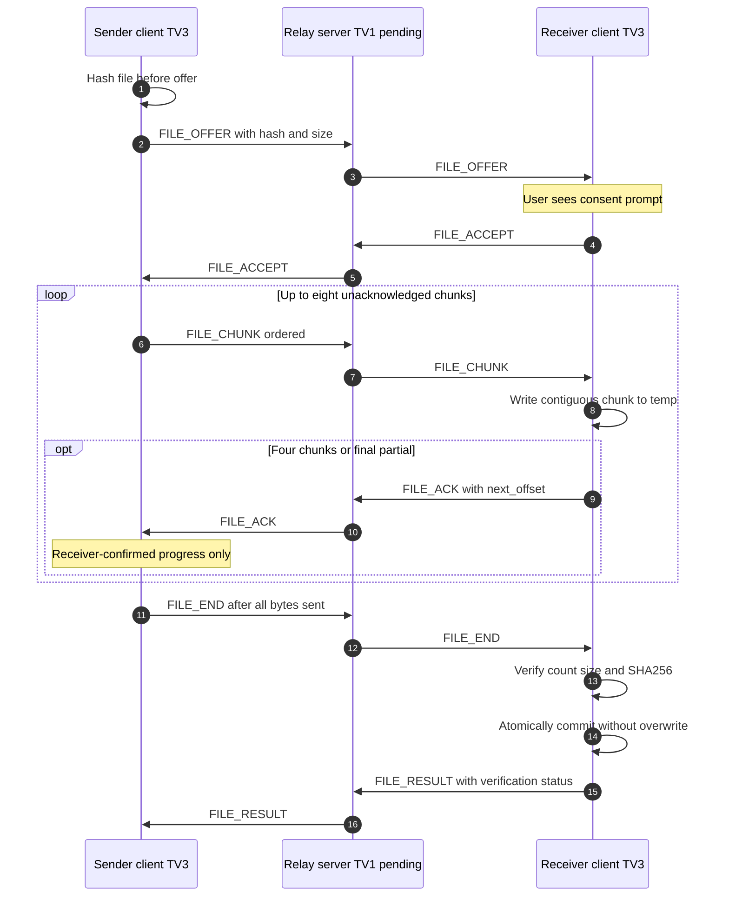

# TV3 file sender and receiver client-side pipeline — implemented with FakeTransport tests

- Empty file sends zero chunks; receiver sends ACK offset 0 after END and then FILE_RESULT.
- Chat/PONG workers must not wait for ACK credit. END is queued behind chunks without waiting for all ACKs.
- Only `FILE_RESULT(ok=true)` is success. 100% acknowledged bytes does not prove file integrity.
- TV2 owns reusable socket-independent transfer validation and TV1 the relay; this diagram is **client logic tested with simulated relay**, not real end-to-end LAN evidence.