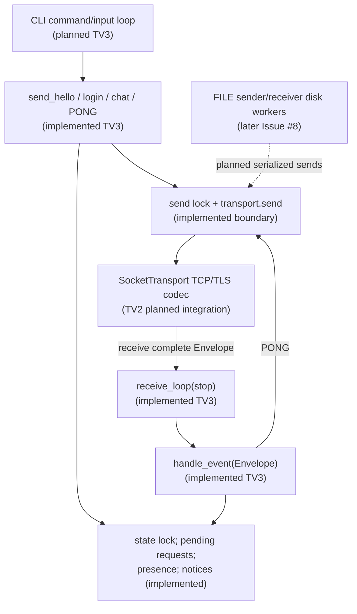

# Client Issue #7 — concurrency and integration boundary

> This is a **mixed implementation / planned integration diagram**. The application-level `receive_loop`, `handle_event` and send/state locks exist in this PR. The interactive CLI thread, verified TLS bootstrap, production socket reader, and file streaming worker are **planned**, not delivered here.

## Implementation notes / risks

1. `receive_loop` calls `transport.receive(timeout=...)` and handles timeout, EOF and protocol failure. `FakeTransport` does not block or model TCP; its test double cannot establish network concurrency guarantees.
2. `_lock` protects application state and `_send_lock` serializes `transport.send` calls; production integration must verify writer ordering at frame-byte level with TV2.
3. Never hold the application state lock during blocking network writes, file I/O, user input, or waits for FILE_ACK credit.
4. Final CLI must be responsive while the receive loop handles PING and incoming events; file workers belong to Issue #8.
5. On disconnect, transition CLOSED, clear pending and presence, and surface a notice. Need real transport tests for races, takeover and EOF.

For production architecture see [transport overview](transport-overview.md) and [file-transfer plan](file-transfer.md).
