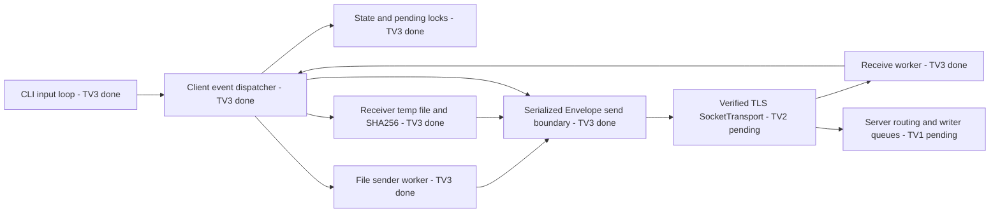

# TV3 concurrency, transport and file boundaries

- The file worker is the only TV3 worker that waits for FILE_ACK credit; interactive input and PING handling are separate.
- TV3's send lock prevents concurrent application calls into `transport.send`; byte framing, priority scheduling and wire-level ordering belong to TV2/TV1.
- On disconnect, transfer state and temporary downloads are cleaned. Actual concurrency guarantees require real socket and 20-client LAN evidence.