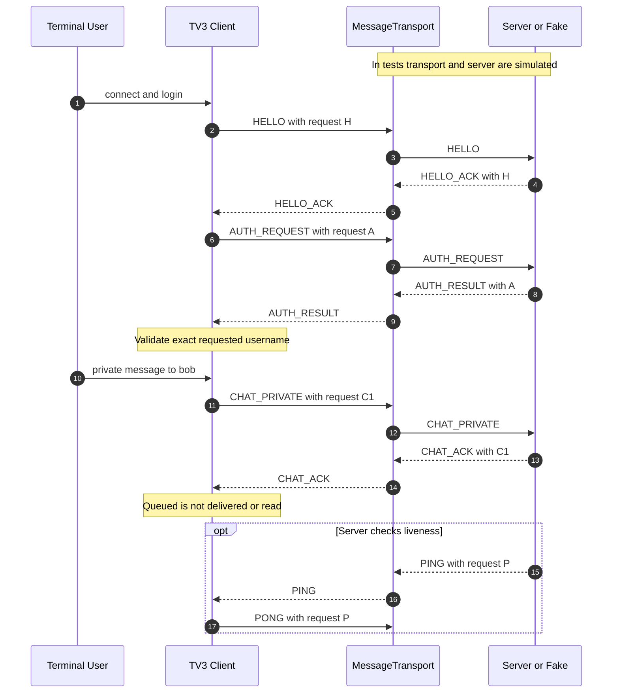

# TV3 HELLO, AUTH and chat correlation — implemented state / planned socket wiring

- Request IDs are unique per session; direct responses must match the pending request ID. File events are correlated by transfer UUID; server ERROR replies can still correlate to the original file request ID.
- Source: `lancollab/client/application.py`; tests: `tests/test_client_logic.py`, `tests/test_client_cli.py`.
- The diagram shows application messages, **not** evidence of functioning TV1/TV2 real networking.