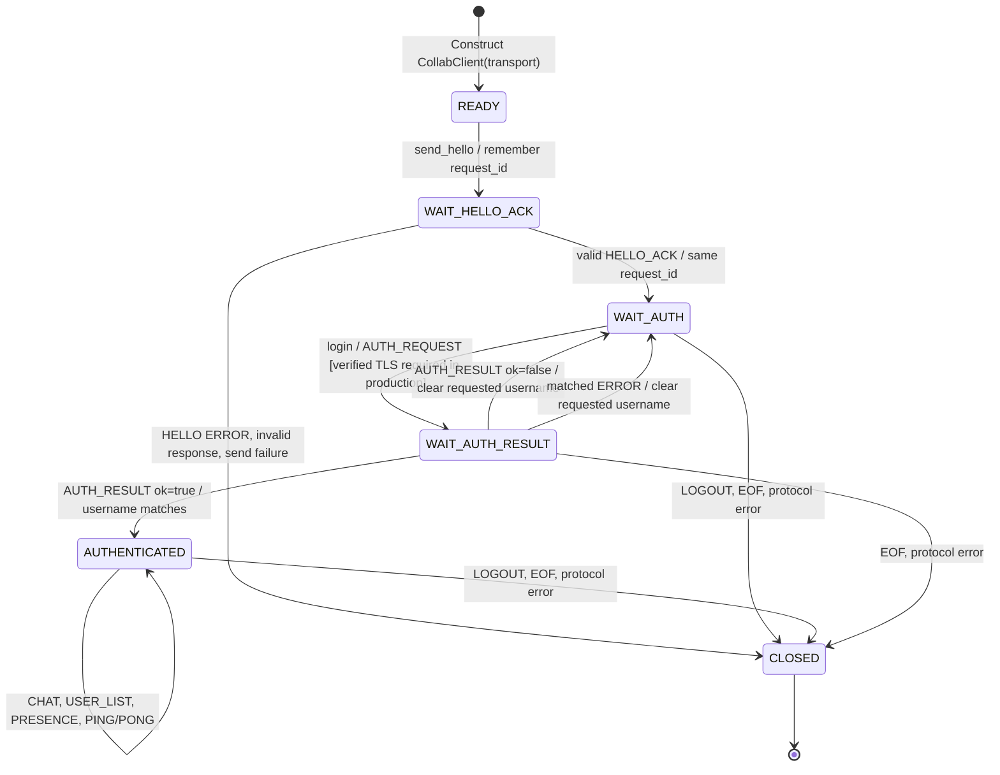

# Client Issue #7 — application state machine (implemented mock logic)

> Scope: transport-independent `CollabClient` on this feature branch. `READY` means an injected transport is supplied, **not** that TCP/TLS has been verified. Actual TLS bootstrap and CLI are integration TODOs. On-wire version remains 1.

## State invariants

- `HELLO` only in `READY`; `AUTH_REQUEST` only after matching `HELLO_ACK`; chat/presence only after matching `AUTH_RESULT(ok=true)`.
- A successful `AUTH_RESULT.username` must equal the username requested by this client; mismatches reject the event and close the session.
- `request_id` is generated per outgoing request, held in `_pending`, and direct replies consume the matching pending entry. PONG is a response and echoes the received request ID.
- `close()` is idempotent and clears username, requested identity, presence, and pending requests.
- Status above is application-level state; it does not imply real network acceptance or secure authentication.

Implementation: [client application](../../lancollab/client/application.py). Related existing design: [connection and chat](connection-and-chat.md).
