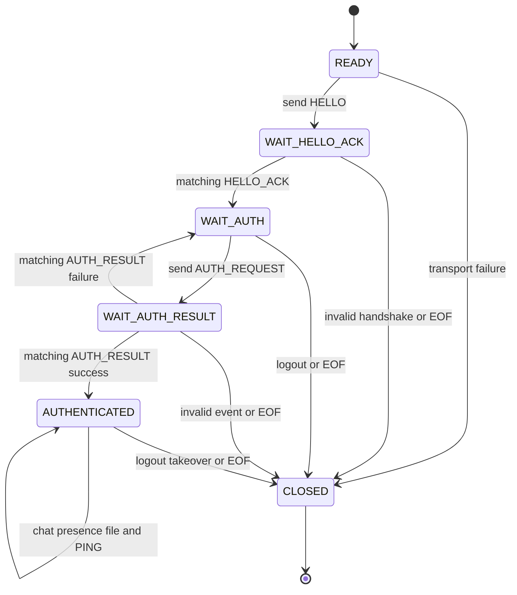

# TV3 client state machine — message logic (implemented, mock tested)

- Code: `lancollab/client/application.py` and CLI in `lancollab/client/cli.py`.
- Incoming `AUTH_RESULT.username` must match the pending login username; untrusted control characters in chat are escaped.
- The `auth_allowed` testing flag is not proof of TLS. `__main__.py` calls a TV2-provided **verified** transport factory; until TV2 implements it, no real login is available.
- Tests with FakeTransport are **not** authenticated real TCP integration evidence.