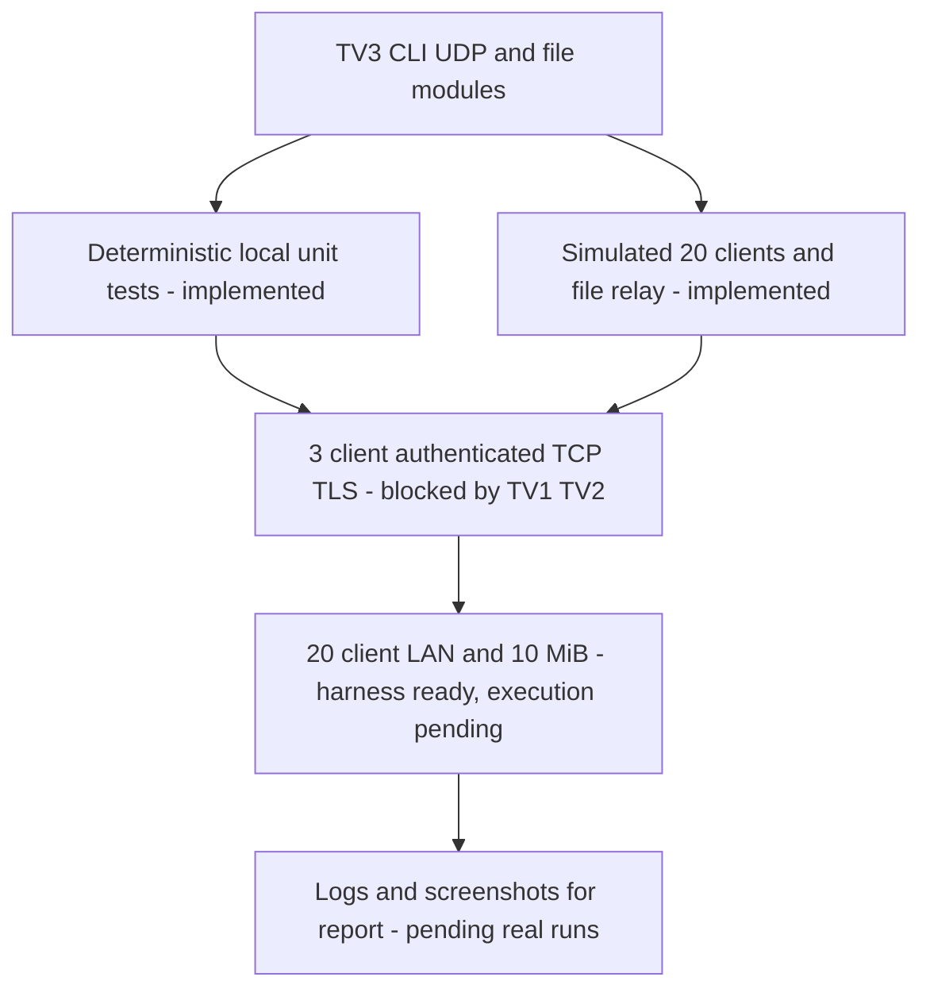

# TV3 tests and acceptance boundaries

No unit, fake, static-check or green CI result can be presented as actual TCP/TLS integration or LAN load evidence. The opt-in harness `scripts/tv3_real_smoke.py` runs only after verified TV2 transport and TV1 server/account setup.