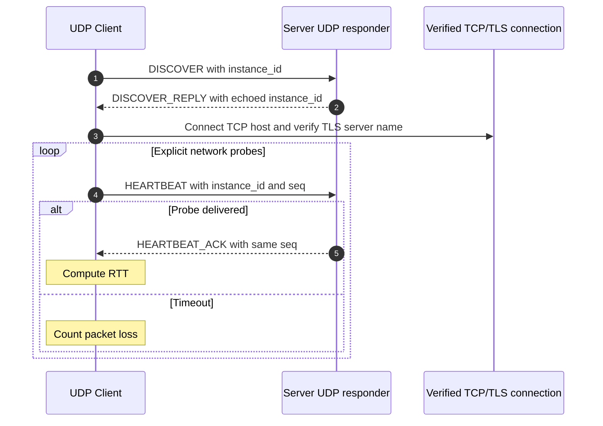

# UDP discovery and network-quality probes

- Client binds a UDP ephemeral port; server UDP port defaults to 40001.
- UDP is not authenticated and does **not** change TCP session presence or auth state. Use `--host` if broadcast is blocked.
- Both client and server participate; record two-host discovery and fallback evidence as described in [acceptance](../acceptance.md).
