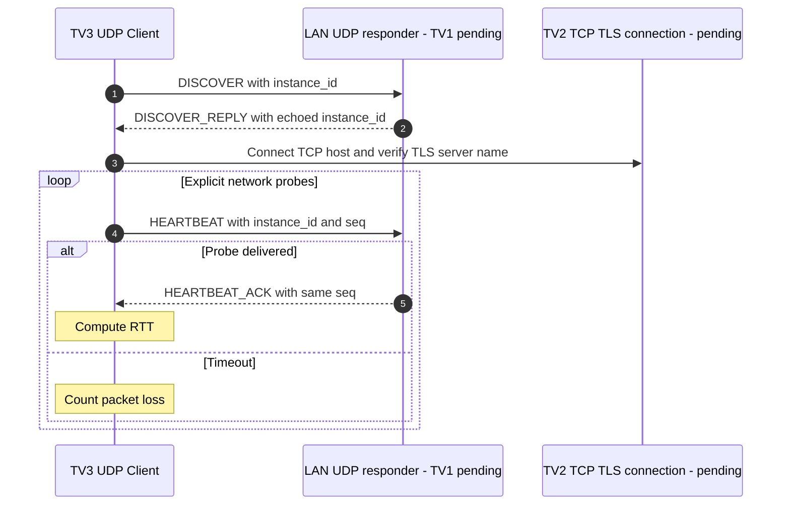

# TV3 UDP discovery and liveness probes — implemented client, pending server

- Client binds a UDP ephemeral port; server UDP port defaults to 40001.
- UDP is not authenticated and does **not** change TCP session presence or auth state. Use `--host` if broadcast is blocked.
- Only client code is implemented in this PR; real LAN discovery requires TV1's responder and network-level testing.