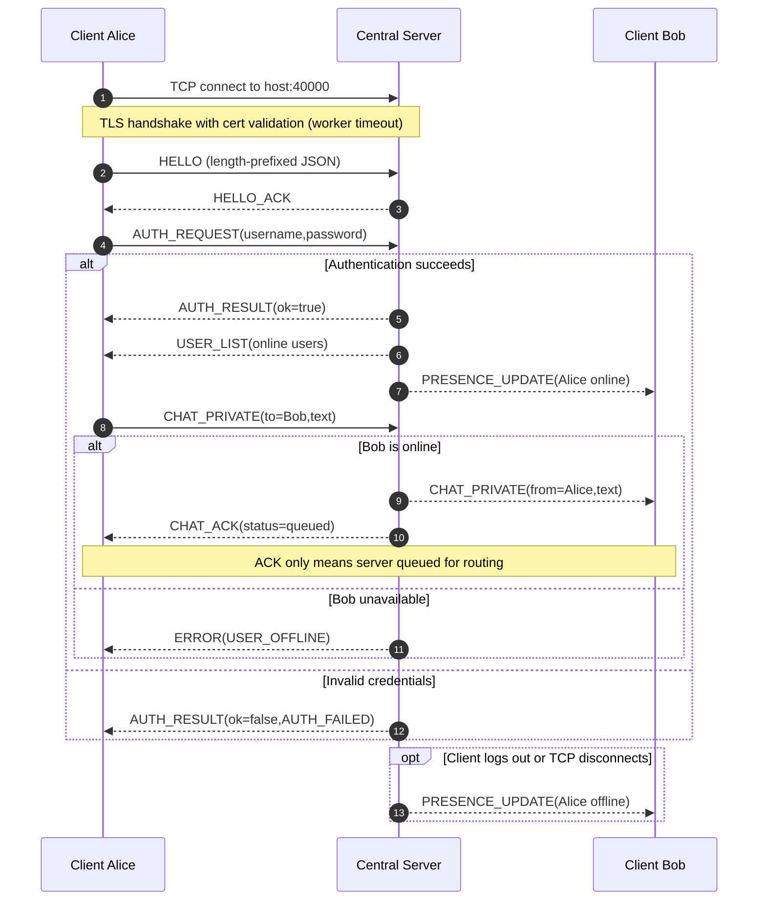

# Connection, authentication and messaging — proposed sequence

**Design artifact** for Issue #2 and CP-A/CP-B. Must be updated to match the implementation.

**TCP data framing:** each application frame is 4-byte BE payload length plus JSON bytes. TLS handles encryption; there is no second JSON-over-HTTP layer.

**UDP separately:** DISCOVER/PRESENCE_BEACON broadcasts, server DISCOVER_REPLY unicast, and unauthenticated HEARTBEAT telemetry do not grant auth or authoritative online state. Manual IP fallback must work when UDP is blocked.
