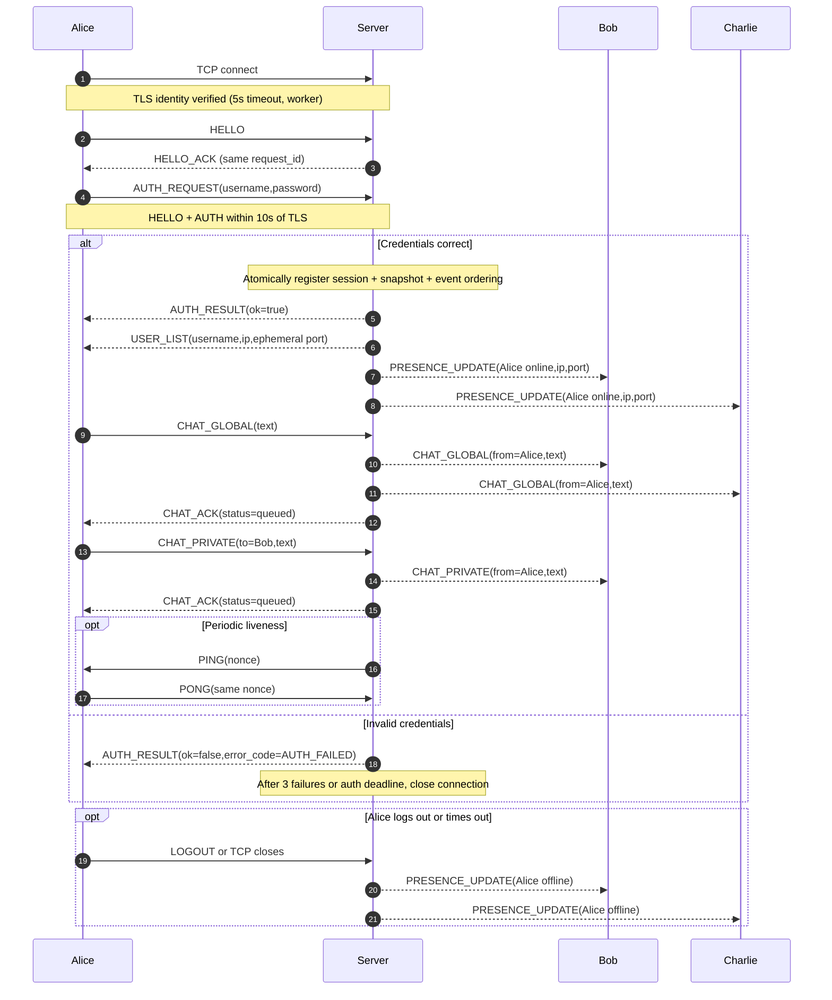

# TLS, authentication, global/private chat and liveness — design revision 1.1

Server sets authenticated `from` on routed messages. `CHAT_ACK` means server queue admission, **not** Bob/Charlie reading the message. For invalid recipient, server sends `ERROR` with the rejected request's exact `request_id`. Terminal CLI must escape malicious ANSI/control characters.
