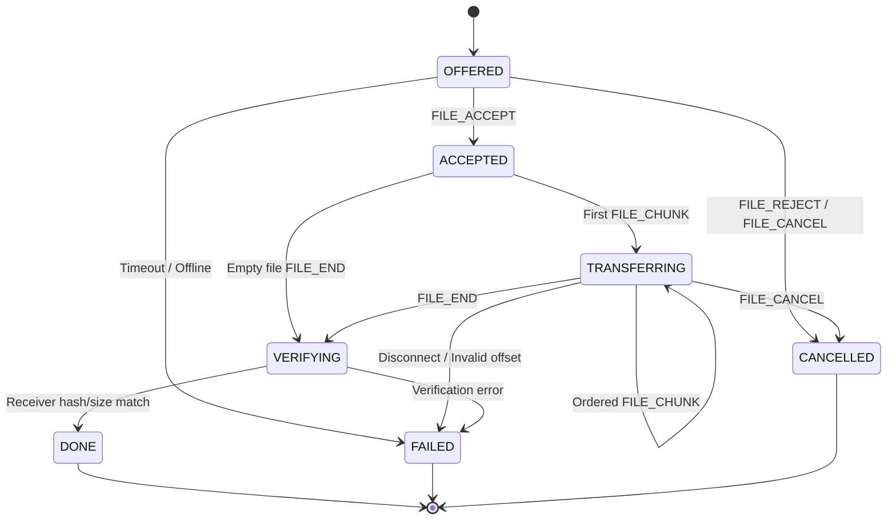

# File transfer and verification — proposed sequence

**Design artifact** for Issues #2 and #8; not evidence that real sockets/files are working.

```mermaid
sequenceDiagram
    autonumber
    participant A as Alice (sender)
    participant S as Server relay
    participant B as Bob (receiver)
    A->>S: FILE_OFFER(transfer_id,to,name,size,sha256)
    S->>B: FILE_OFFER(transfer_id,from,name,size,sha256)
    alt Bob accepts
        B-->>S: FILE_ACCEPT(transfer_id)
        S-->>A: FILE_ACCEPT(transfer_id)
        loop Chunk stream (bounded, in order)
            A->>S: FILE_CHUNK(transfer_id,seq,offset,data_b64)
            S->>B: FILE_CHUNK(transfer_id,seq,offset,data_b64)
            Note over S,B: File queue bounded; control frames prioritized
        end
        A->>S: FILE_END(total_chunks)
        S->>B: FILE_END(total_chunks)
        Note over B: Check exact byte count and SHA-256 in temp file
        alt Integrity OK
            B-->>S: FILE_RESULT(ok=true)
            S-->>A: FILE_RESULT(ok=true)
        else Size/hash invalid
            B-->>S: FILE_RESULT(ok=false,reason)
            S-->>A: FILE_RESULT(ok=false,reason)
        end
    else Bob rejects
        B-->>S: FILE_REJECT(transfer_id)
        S-->>A: FILE_REJECT(transfer_id)
    end
    opt Either endpoint disconnects/cancels
        S-->>A: FILE_CANCEL or ERROR
        S-->>B: FILE_CANCEL or ERROR
    end
```

## Transfer states



The server relays streams only for an online, consenting recipient; no persistent server-side file storage. Server queue ACK and TCP send success do **not** prove file integrity. Only receiver `FILE_RESULT(ok=true)` closes transfer successfully.

## Shared socket scheduling

Use a serialized writer and two bounded queues; fairness between control and file frames. If a receiver is slow, pause/limit file production and fail the transfer after a defined timeout rather than growing memory indefinitely. This improves application scheduling but cannot remove inherent TCP-level head-of-line blocking.
