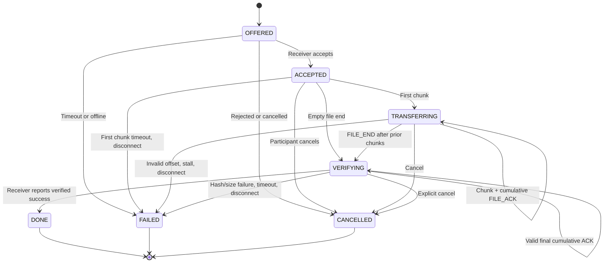

# File transfer + receiver-confirmed flow control — design revision 1.2

**Design only.** This visual is not a passed networking acceptance test.

```mermaid
sequenceDiagram
    autonumber
    participant A as Alice (authenticated sender)
    participant S as Server (state, credit, relay)
    participant B as Bob (authenticated receiver)
    A->>S: FILE_OFFER(transfer_id,to,name,size,sha256)
    S->>B: FILE_OFFER(transfer_id,from,name,size,sha256)
    alt Receiver accepts
        B->>S: FILE_ACCEPT(transfer_id)
        S->>A: FILE_ACCEPT(transfer_id)
        loop Window W=8: at most 8 unacknowledged chunks
            A->>S: FILE_CHUNK(transfer_id,seq,offset,data_b64)
            S->>B: FILE_CHUNK in ordered file FIFO
            Note over B: Write contiguous bytes into temp file
            opt After 4 chunks or final partial batch
                B->>S: FILE_ACK(next_offset)
                S->>A: FILE_ACK(next_offset) via priority control queue
                Note over A: Advance cumulative receiver-ACK credit and progress
            end
        end
        Note over A: Send END after all bytes; do not wait for final ACK
        A->>S: FILE_END(total_chunks)
        Note over S,B: FILE_END follows all chunks in SAME file FIFO
        S->>B: FILE_END(total_chunks)
        Note over B: Verify exact size, chunk count, SHA-256
        B->>S: Final FILE_ACK(next_offset=size) if not already sent
        Note over S: Final ACK remains valid in VERIFYING
        B->>S: FILE_RESULT(ok=true / false)
        S->>A: FILE_RESULT(ok=true / false)
    else Receiver rejects
        B->>S: FILE_REJECT(transfer_id)
        S->>A: FILE_REJECT(transfer_id)
    end
    opt Timeout, disconnect, queue full or participant cancels
        Note over S: Mark transfer terminal, discard queued chunks/end
        S-->>A: FILE_CANCEL(reason) if still connected
        S-->>B: FILE_CANCEL(reason) if still connected
    end
```

## Sender/receiver/server state machine



## Authorization

Sender alone originates OFFER, CHUNK and END; receiver alone originates ACCEPT, REJECT, ACK and RESULT; both may CANCEL. Server keys active transfers by globally unique transfer_id and binds both exact participant session IDs. Retain terminal IDs per session (1024 admitted offers/session); reject reuse. Takeover cancels transfers for the replaced session. Server verifies each role, state, size/count and ACK boundary before forwarding. Max one active incoming transfer per receiver in MVP.

The `FILE_ACK` verifies cumulative bytes **written** by receiver, not final SHA-256 integrity. `FILE_RESULT(ok=true)` is the only successful terminal confirmation. A file is not stored on the server.
