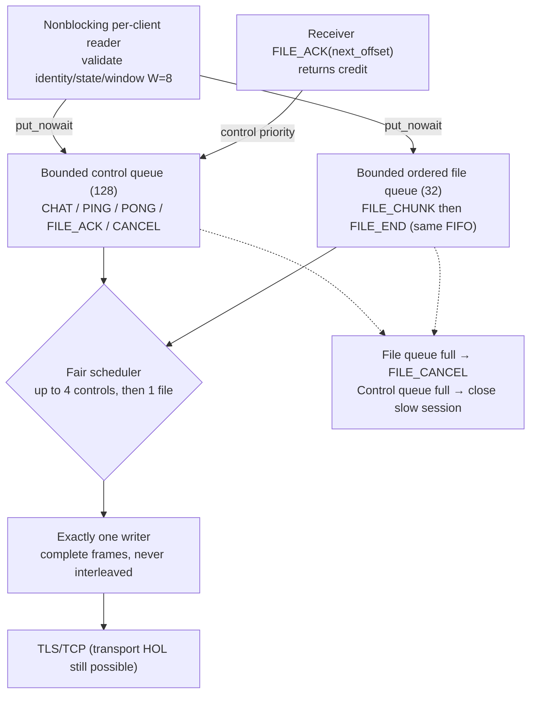

# Nonblocking queue admission and single writer — design revision 1.1

- Neither `queue.put()` nor socket send/receive may block a shared registry lock or a reader responsible for incoming PONG/chat.
- Receiver sends `FILE_ACK` every four contiguous chunks or when final partial batch is complete. Sender may send at most eight unacknowledged chunks.
- On cancellation, invalidate/purge chunks and END already waiting in queue; incoming late frames for terminal transfer are ignored/rejected.
- Transfer progress shown as receiver-confirmed `next_offset`, not sender writes to local TCP.
- These are design parameters, not measured throughput or implemented behavior.
