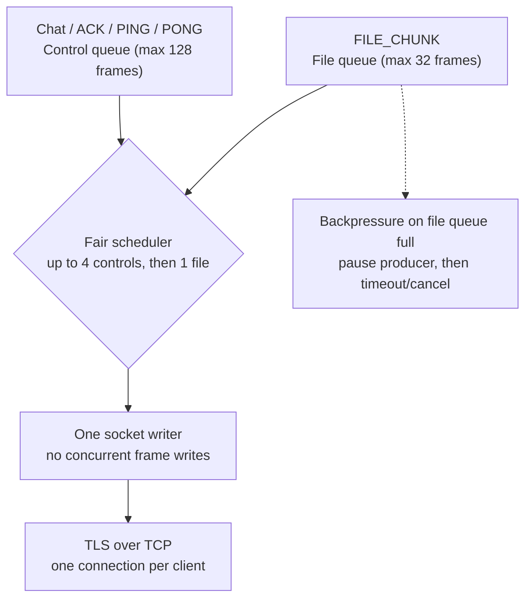

# Serialized outbound writer and backpressure — baseline v1.0

The same TCP/TLS connection carries both chat/control and file chunks. A **single writer** serializes complete frames to prevent byte interleaving; two bounded queues reduce application-level interference.

The numbers and ratio are **initial design limits**, not benchmark-proven optimal values. The scheduler must avoid file starvation under continuous control traffic. TCP-level head-of-line blocking remains possible; benchmark chat/PING latency while transferring a large file.

For the one-week MVP, do not open a second TCP connection unless the single-connection architecture fails acceptance tests.
