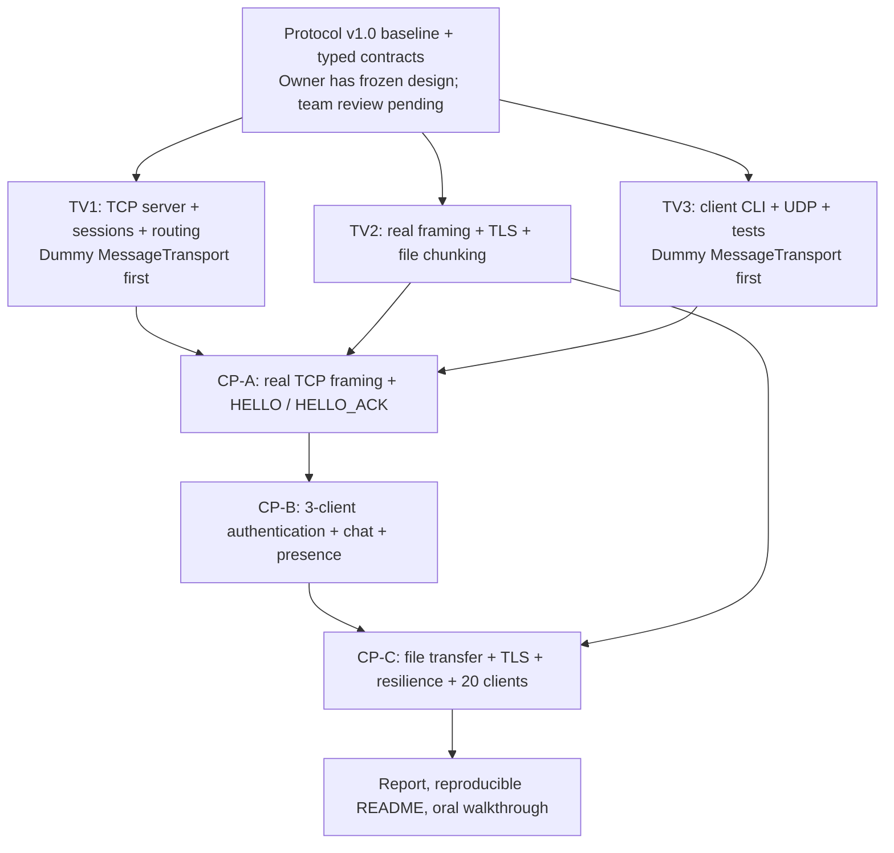

# Parallel work and integration checkpoints

Three team members can implement independently using a shared message contract and in-memory `FakeTransport`. **Mocks alone do not satisfy any real networking milestone.**

**Gates:** [CP-A — Issue #16](https://github.com/1K-Keem/lan-collab/issues/16), [CP-B — Issue #17](https://github.com/1K-Keem/lan-collab/issues/17), [CP-C — Issue #18](https://github.com/1K-Keem/lan-collab/issues/18). Exact acceptance criteria are in [checkpoints.md](../checkpoints.md).
