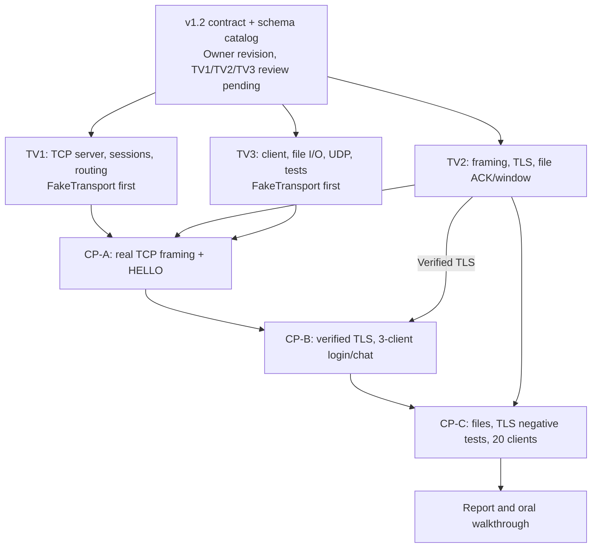

# Parallel development and checkpoint gates — v1.2

The team reviews v1.2 contract in [Issue #2](https://github.com/1K-Keem/lan-collab/issues/2). [CP-A #16](https://github.com/1K-Keem/lan-collab/issues/16), [CP-B #17](https://github.com/1K-Keem/lan-collab/issues/17), [CP-C #18](https://github.com/1K-Keem/lan-collab/issues/18) require **actual socket-based evidence**, not dummy-only CI.
