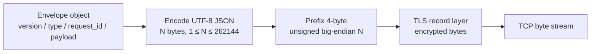

# TCP/TLS application frame — baseline v1.0

TCP transports bytes, **not** messages. Application framing is required even when a TLS socket is used.



```text
+--------------------+-----------------------------------------------+
| 4-byte length (BE) | UTF-8 JSON body, exactly N bytes (N <= 256KiB) |
+--------------------+-----------------------------------------------+
```

Sample application JSON body (illustration only):

```json
{
  "version": 1,
  "type": "CHAT_PRIVATE",
  "request_id": "req-001",
  "payload": {"to": "bob", "text": "Hello Bob!"}
}
```

The receiving side first reads **exactly 4 bytes** for N; validates N before allocating; then reads **exactly N bytes** for UTF-8 JSON, validates schema/version/state, and dispatches the message. A single `recv()` may receive only part of a frame, or data spanning several frames. All outgoing sends on the same connection must be serialized.

No HTTP, WebSocket, or newline-delimited JSON is used. See [protocol-spec.md](../protocol-spec.md).
