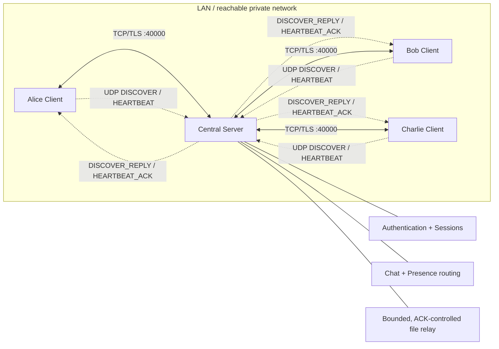

# Transport and architecture overview — design revision 1.2

- Client UDP sockets bind **ephemeral source ports** (server listens on UDP 40001); discovery can use broadcast, heartbeat unicast.
- UDP replies help measure RTT/loss. They have **no security or session-state authority**.
- TCP/TLS carries authenticated presence, chat and file data; verified TLS server identity is independent of changing DHCP address.
- See [protocol spec](../protocol-spec.md), [file transfer](file-transfer.md), [queue scheduler](outbound-queues.md).
