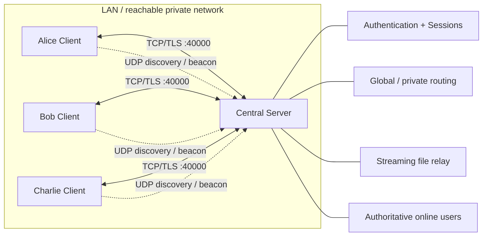

# Transport and architecture overview — baseline v1.0

This is the **intended design**, not proof of a running network application. The server is the authenticated routing authority; file bytes are relayed and not stored on the server.

## Transport allocation

| Transport | Role | Security meaning |
| --- | --- | --- |
| TCP + TLS | Authentication, chats, file chunks, server ACKs, TCP PING/PONG | Client verifies server certificate; encrypted in transit |
| UDP :40001 | DISCOVER/DISCOVER_REPLY, PRESENCE_BEACON, HEARTBEAT | Unauthenticated, never creates or renews a logged-in session |
| Manual host/IP | Fallback to reach TCP service when UDP broadcast fails | TLS certificate identity must **still** be verified |

The client may connect to a changing DHCP IP while verifying a fixed DNS identity such as `lan-collab.local` (only if the certificate is trusted and includes that DNS name in SAN).

See [protocol v1.0](../protocol-spec.md) and [connection/chat flow](connection-and-chat.md).
