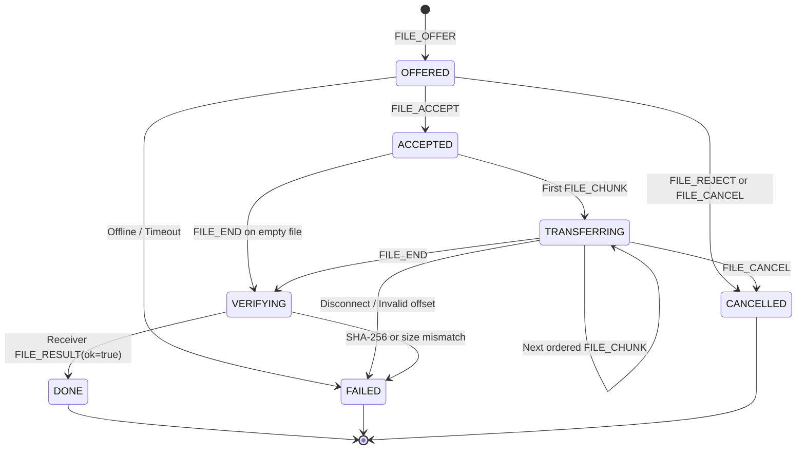

# LAN Collab wire protocol v1.0 — frozen implementation baseline

**Status: FROZEN FOR IMPLEMENTATION by repository owner (25 Oct 2026), pending individual team review.** The schema, message types, ACK meanings and wire framing are the shared v1.0 contract for TV1/TV2/TV3. The user has chosen to proceed with this baseline. Teammates must still record reviews in Issue #2; do not represent their approval as already obtained. Any incompatible change requires a jointly reviewed PR.

## Transport and framing

- One persistent TCP connection **wrapped in TLS** per authenticated client for text, control and file chunks.
- 4-byte unsigned big-endian byte length followed by a UTF-8 JSON object (not HTTP or WebSocket).
- Max JSON body: **262144 bytes**. Reader must reject zero/oversized length and read the exact length; `recv(n)` is not a packet boundary. One synchronized writer per connection.
- Envelope required keys: `version` (integer 1), `type` (string), `request_id` (nonempty string, unique per originating client request), `payload` (object).
- Response/event reuses or references the initiating request as specified below. Unknown `type`, invalid field, size or state => `ERROR` (close connection on unsafe framing).
- All user-controlled strings have bounded lengths; username <= 32, chat <= 4096 UTF-8 bytes; filename is a **basename**, <= 255 UTF-8 bytes; no absolute or parent paths.
- Suggested port defaults: TCP 40000; UDP 40001. Both CLI-configurable. Values are design choices, not assigned requirements.

## Concrete message payload schemas

Notation: fields without `?` are required; `?` indicates optional. Authentication is mandatory before chat/file traffic. Server-generated `from` is derived from the session, **never trusted from a client**.

| Type | Direction | Required payload | Semantics |
| --- | --- | --- | --- |
| `HELLO` | C->S | `client_name: str` | First application message after TLS handshake |
| `HELLO_ACK` | S->C | `server_name: str, protocol_version: int` | Application handshake accepted |
| `AUTH_REQUEST` | C->S | `username: str, password: str` | Password sent only over verified TLS |
| `AUTH_RESULT` | S->C | `ok: bool`; optional `username: str, error_code: str` | S->C login result |
| `USER_LIST` | S->C | `users: [{username: str, ip: str, port: int}]` | Snapshot of online authenticated users |
| `PRESENCE_UPDATE` | S->C | `username: str, status: "online"\|"offline"` | Authoritative state from TCP sessions |
| `CHAT_GLOBAL` | C->S | `text: str` | Server validates and fans out |
| `CHAT_GLOBAL` | S->C | `from: str, text: str` | Routed event; server sets `from` |
| `CHAT_PRIVATE` | C->S | `to: str, text: str` | Recipient online required |
| `CHAT_PRIVATE` | S->C | `from: str, text: str` | Routed event |
| `CHAT_ACK` | S->C | `ref_request_id: str, status: "queued"` | Server queued routing; **not** recipient read/durable delivery |
| `FILE_OFFER` | C->S | `transfer_id: uuid-str, to: str, name: str, size: int, sha256: 64-hex` | Proposed max size 50 MiB, including zero-length |
| `FILE_OFFER` | S->C | `transfer_id, from: str, name, size, sha256` | Request receiver consent |
| `FILE_ACCEPT` | C->S->C | `transfer_id: uuid-str` | Only designated receiver may accept |
| `FILE_REJECT` | C->S->C | `transfer_id, reason?: str` | Refuse before chunks are sent |
| `FILE_CHUNK` | C->S->C | `transfer_id, seq: int, offset: int, data_b64: str` | 0-based sequence, byte offset, <= 16 KiB decoded bytes |
| `FILE_END` | C->S->C | `transfer_id, total_chunks: int` | Signals all chunks have been submitted |
| `FILE_RESULT` | C->S->C | `transfer_id, ok: bool, reason?: str` | Receiver's end-to-end integrity verdict |
| `FILE_CANCEL` | C->S->C | `transfer_id, reason?: str` | Cancel while not terminal |
| `PING` | C<->S | `nonce: str` | TCP application liveness check |
| `PONG` | C<->S | `nonce: str` | Echo nonce |
| `LOGOUT` | C->S | `reason?: str` | Session close |
| `ERROR` | S->C | `ref_request_id: str, code: str, message: str` | Explicit rejected request |

`request_id` on routed events may be a server-created ID; ACK correlation always uses `ref_request_id`. `FILE_CHUNK` must not be sent before acceptance. Unknown/excess/duplicate/out-of-order offsets are rejected; no resume in MVP.

## Error codes

`INVALID_FRAME`, `INVALID_MESSAGE`, `UNSUPPORTED_VERSION`, `INVALID_STATE`, `NOT_AUTHENTICATED`, `AUTH_FAILED`, `DUPLICATE_LOGIN`, `USER_OFFLINE`, `RECIPIENT_NOT_FOUND`, `FILE_TOO_LARGE`, `FILE_REJECTED`, `TRANSFER_NOT_FOUND`, `INVALID_CHUNK_OFFSET`, `TRANSFER_FAILED`, `QUEUE_FULL`, `TIMEOUT`, `INTERNAL_ERROR`.

Do not reveal stored password hashes, stack traces or secrets in client-visible `ERROR`.

## File transfer state machine (per transfer at sender/receiver/server)

A successful TCP `send` or server queue admission is **not** proof that the receiver stored the file. Success requires `FILE_RESULT(ok=true)` after receiver verifies file size and SHA-256. Receiver writes to a temporary file then renames safely on success; server only relays to a currently online consenting receiver, does not persist file chunks.

## Queues and fairness (proposal)

- One socket writer serializes complete frames.
- Separate bounded **control/chat queue** and **file queue**; example limits: 128 control frames and 32 file frames per destination. Tune during load test.
- Scheduler prioritizes controls but guarantees a file turn regularly (e.g. up to 4 control frames, then 1 file frame); it must never interleave bytes within a frame.
- On file queue saturation: pause/slow sender (bounded backpressure); after defined timeout, fail/cancel transfer. Do not let any producer allocate unbounded memory. Keep timeouts independent of UDP.
- Shared TCP may still have transport-level head-of-line blocking; measure chat latency under file load. Dedicated file connection only if the single-connection design fails acceptance tests.

## UDP protocol (separate from TLS)

- UDP datagrams are independent JSON objects (no TCP 4-byte prefix), max 1200 bytes.
- `DISCOVER` broadcast: `{version:1,type:"DISCOVER",instance_id:str}`.
- `DISCOVER_REPLY` server unicast: `{version:1,type:"DISCOVER_REPLY",server_name:str,tcp_port:int}`.
- `PRESENCE_BEACON` client broadcast: `{version:1,type:"PRESENCE_BEACON",instance_id:str}`.
- `HEARTBEAT` client->server UDP: `{version:1,type:"HEARTBEAT",instance_id:str,seq:int}`.
- Manual IP/port is mandatory fallback for firewalls, multi-NIC/VPN and disabled broadcasts.
- **Security:** UDP is unauthenticated discovery/telemetry only; spoofable packets must NEVER create authenticated session, reset TCP session timeout, or mark a disconnected user online. Server's online list comes from authenticated TCP session state.

## TLS and authentication

- TLS handshake runs in per-client worker with a bounded handshake timeout; never in the blocking accept loop.
- Certificate trusted by client, hostname verified. A dev certificate may be issued for fixed name `lan-collab.local`; TLS `server_hostname` can use that fixed name while TCP connects to a chosen IP, avoiding repeated cert regeneration after DHCP IP changes.
- No `CERT_NONE`/unconditional verification bypass in final implementation. No real private keys committed. Provide cross-platform cert-generation script as a separate student task.
- Proposed SQLite account store with salted password hash; duplicate usernames online -> `DUPLICATE_LOGIN`.
- TCP `PING/PONG` is authoritative liveness input. Proposed interval 10s, missed 3 consecutive responses -> cleanup; also cleanup immediately on connection EOF/errors. UDP does not prolong sessions.

## Protocol freeze and remaining reviews

- [x] Repository owner freezes v1.0 protocol as the implementation baseline.
- [ ] TV1 reviews server routing/ACK/session states.
- [ ] TV2 reviews codec, file offsets/chunks, TLS and queue limits.
- [ ] TV3 reviews client CLI, UDP/heartbeat and event envelopes.
- [ ] All three confirm timeout values, duplicate-login policy, file caps and public/private repo settings.
- [x] Baseline sequence/state diagrams documented (design only).
- [ ] Sequence diagrams confirmed against actual integration.

The small `lancollab.common` interfaces and `tests/fixtures/` are *test doubles/contracts*, not working network implementation. Do not claim rubric milestones complete until implementation + real socket tests pass.

## Visual references

- [Transport overview](diagrams/transport-overview.md)
- [TCP framing](diagrams/tcp-framing.md)
- [Connection/authentication/chat sequence](diagrams/connection-and-chat.md)
- [File transfer sequence and states](diagrams/file-transfer.md)
- [Outbound queue scheduler](diagrams/outbound-queues.md)
- [Parallel development dependency graph](diagrams/parallel-work-dependencies.md)
