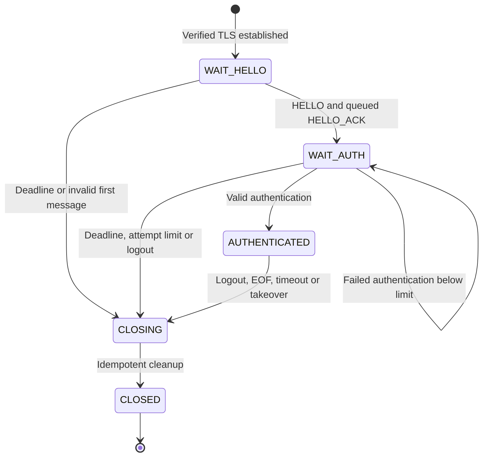
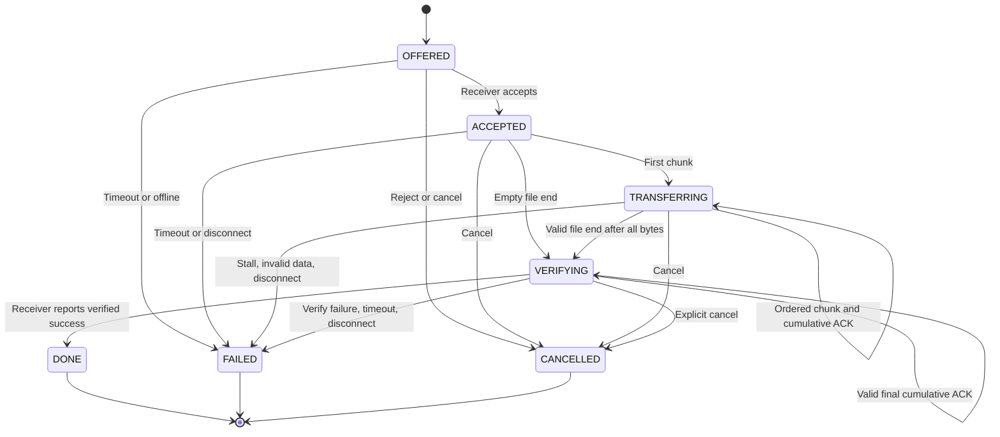

# LAN Collab application protocol — design revision 1.2

**Status:** REVISED IMPLEMENTATION BASELINE — **TEAM REVIEW PENDING** (25 October 2026). Owner requested fixes after a protocol design review. This supersedes the v1.1 design; TV1, TV2 and TV3 must confirm the changed contract in [Issue #2](https://github.com/1K-Keem/lan-collab/issues/2) before merging incompatible networking handlers. The **wire envelope version remains integer `1`** because production has not shipped; “1.2” names this documentation revision, not a different on-wire version.

**Scope:** Python 3.11+, raw TCP and UDP sockets, one server, no HTTP/WebSocket/P2P, no persistent server-side file storage, no resuming interrupted transfers.

## 1. TCP/TLS framing and message envelope

- Persistent TLS-protected TCP connection for chat, login, file and connection control; default service port `40000` (CLI configurable).
- A single application frame is `uint32_big_endian(body_length)` followed by **exactly** `body_length` bytes of UTF-8 JSON. Permitted length is 1–262144 bytes; reject other lengths before allocation. TCP `recv` may return a fragment or several frames.
- Required top-level JSON object keys are **exactly** `version` (integer 1), `type` (string), `request_id` (1–64 printable ASCII characters, code points 0x21–0x7E) and `payload` (JSON object). Reject unknown/extra top-level or payload keys, duplicate JSON keys, invalid types and unsupported types in v1; distinguish `bool` from `int` in Python. Numeric limits below are protocol constraints, not suggestions.
- Client request `request_id` is unique on that session. **Direct server response** (`HELLO_ACK`, `AUTH_RESULT`, `CHAT_ACK`, `ERROR`, `PONG`) copies that request's `request_id`; no `ref_request_id` field. **Forwarded or unsolicited events** use a fresh server-generated `request_id`. File transfer messages correlate by `transfer_id` rather than envelope IDs. `PONG` is also a direct response: it copies the PING request ID and nonce. Client-originated PONG responses are exempt from the client-request uniqueness rule; they do not create new requests. Reject duplicate IDs on actual client requests without re-executing the operation. Bound the per-session request-ID history to 65536 entries; on exhaustion reject further requests and close the connection; the client reconnects with a fresh session. Never evict IDs and then accept replays.
- If a frame is unparsable or has no trustworthy `request_id`, close the connection without attempting `ERROR`. If JSON envelope is parseable and has a valid request ID but the request is semantically invalid, return `ERROR` with that same request ID, or `AUTH_RESULT(ok=false)` on auth failure.
- File and message strings are limited by their UTF-8 byte length where stated. Username: `[A-Za-z0-9_.-]{1,32}`, case-sensitive. Chat: 1–4096 UTF-8 bytes. Filename: basename <= 255 UTF-8 bytes. Sender-provided `from` is **never** trusted; it comes from authenticated server session.
- `lancollab/common/message_schema.py` is the **declarative schema catalog** for directions/fields. The production codec/validators must consume it and implement full types, ranges and state checks; currently it is NOT a functional validator. Tests/fixtures reference that catalog to catch drift.

## 2. TCP message schema

Notation: C→S = client request, S→C = server response/event; `?` means optional, quoted tokens are literal allowed values. The two directions of a message may have different payload fields.

| Message | Direction | Required payload; optional payload | Semantics |
| --- | --- | --- | --- |
| `HELLO` | C→S | `client_name:str` | First application message after TLS |
| `HELLO_ACK` | S→C | `server_name:str, protocol_version:int(1)` | Direct response |
| `AUTH_REQUEST` | C→S | `username:str, password:str` | Only over verified TLS |
| `AUTH_RESULT` | S→C | `ok:bool`; `username?:str, error_code?:str` | Success requires username and forbids error_code; failure requires error_code=AUTH_FAILED and forbids username |
| `USER_LIST` | S→C | `users:[{username:str, ip:str, port:int}]` | Atomic authenticated presence snapshot; port = client TCP **ephemeral source** port |
| `PRESENCE_UPDATE` | S→C | `username:str, status:"online"\|"offline"`; **online requires** `ip:str, port:int`; offline omits them | Ordered relative to USER_LIST under registry lock |
| `CHAT_GLOBAL` | C→S | `text:str` | Broadcast to authenticated users, excluding sender; agreed behavior |
| `CHAT_GLOBAL` | S→C | `from:str, text:str` | Routed event |
| `CHAT_PRIVATE` | C→S | `to:str, text:str` | Require online recipient |
| `CHAT_PRIVATE` | S→C | `from:str, text:str` | Routed event |
| `CHAT_ACK` | S→C | `status:"queued"` | Direct reply: **server queue admission only**, not recipient read/delivery |
| `FILE_OFFER` | C→S | `transfer_id:uuid-str, to:str, name:str, size:int, sha256:64 lowercase hex` | 0–50 MiB; receiver must consent |
| `FILE_OFFER` | S→C | `transfer_id, from:str, name, size, sha256` | Incoming transfer notification |
| `FILE_ACCEPT` | C→S/S→C | `transfer_id:uuid-str` | Only receiver may originate |
| `FILE_REJECT` | C→S/S→C | `transfer_id`; `reason?:str` | Only receiver may originate |
| `FILE_CHUNK` | C→S/S→C | `transfer_id, seq:int, offset:int, data_b64:str` | Only sender originates; 0-based `seq`, exact contiguous byte offsets; decoded size 1–16384 |
| `FILE_ACK` | C→S/S→C | `transfer_id, next_offset:int` | Only receiver originates; cumulative contiguous bytes written to temp file |
| `FILE_END` | C→S/S→C | `transfer_id, total_chunks:int` | Only sender originates; queue *behind chunks* for same transfer |
| `FILE_RESULT` | C→S/S→C | `transfer_id, ok:bool`; `reason?:str` | Only receiver originates; success after exact size + SHA-256 |
| `FILE_CANCEL` | C→S/S→C | `transfer_id, reason:str` | Either participant originates; server also generates on timeout, disconnect or queue failure |
| `PING` / `PONG` | Both | `nonce:str` | TCP authenticated liveness; PONG echoes nonce |
| `LOGOUT` | C→S | `reason?:str` | Client requests session closure |
| `ERROR` | S→C | `code:str, message:str` | Direct reply, same `request_id` as rejected request |

**Strict schema:** no unknown payload keys; username, filename, size, nonnegative sequence/offset, hash and valid JSON types must be checked by TV2's real codec/server handlers. A schema-valid message can still be rejected for unauthorized sender, invalid state or capacity. `FILE_ACK` and `FILE_RESULT` forwarded by server get new event `request_id` and are correlated with `transfer_id`.

## 3. Authentication and sessions

- **No REGISTER over the network in MVP.** Administrator provisions accounts using server CLI `python -m lancollab.server --add-user alice` (command is an implementation TODO), securely prompts for password and stores salted password hashes (e.g. `hashlib.scrypt` or PBKDF2) in SQLite. README must document exact command after implementation.
- TLS handshake deadline: **5s**, executed in a bounded client worker, never in the accept loop. Complete `HELLO` plus `AUTH_REQUEST` within **10s** from TLS completion (client gathers username/password before opening the connection). Close silent/unauthenticated clients at deadline. Allow at most **3** failed authentication attempts per connection; use `AUTH_FAILED` generically for unknown user and bad password.
- Authenticated **new session replaces old session** for the same username (atomic takeover, after successful password check); close old connection. Session registry uses an identity/generation token so old connection cleanup cannot remove or mark newer session offline.
- On login, under one registry lock: install authenticated session, build consistent USER_LIST snapshot, register ordering of future PRESENCE_UPDATE events, and queue notifications **nonblocking**; never block socket I/O while holding registry lock. Readers should handle duplicate/ordered presence updates idempotently.
- Server retains authenticated username, TCP peer IP and **ephemeral source port**. If exposed to clients, online PRESENCE_UPDATE carries same `ip`/`port` as USER_LIST; offline update does not carry them.
- Each accepted TCP connection has an opaque, server-local `session_id`, never reused during the server process. It is not a wire field. Authenticate and route only while that session is the current registry identity; stale buffered requests cannot act as a replacement session.
- Transfers bind immutable sender and receiver **session IDs**, as well as usernames. On successful takeover, atomically invalidate the old session, cancel its offers/transfers with `FILE_CANCEL(reason="SESSION_REPLACED")` to surviving peers, install the new session and enqueue presence changes. Do not migrate transfer state or queued events to the replacement connection. Old cleanup can remove only records bearing its exact session ID. Defer socket shutdown and other blocking I/O until after releasing locks.
- Every outbound event targets a concrete `SessionIdentity`, not a username lookup at send time. A writer must discard an event whose target session has been invalidated. The replacement client must accept a new file offer; it has no old temporary file or hash state.
- Filter untrusted ANSI escapes and control characters before rendering username/messages/filenames on CLI; preserve safe user text according to a documented display policy.

### Connection states and allowed messages

| State | Allowed client-originated messages | Transition / rejection |
| --- | --- | --- |
| WAIT_HELLO | HELLO | Queue HELLO_ACK, then WAIT_AUTH; other messages close the connection |
| WAIT_AUTH | AUTH_REQUEST, LOGOUT | Success → AUTHENTICATED; failure stays until attempt/deadline limit; other valid requests → ERROR(INVALID_STATE) |
| AUTHENTICATED | Chat/file requests, PING, matching PONG, LOGOUT | Repeated HELLO/AUTH_REQUEST → ERROR(INVALID_STATE); enforce per-transfer state and roles |
| CLOSING / CLOSED | None | No more dispatch; invalidate session and perform idempotent cleanup |

After TLS, the server starts in WAIT_HELLO. Client waits for HELLO_ACK before AUTH_REQUEST and for AUTH_RESULT(ok=true) before authenticated operations. Server queues AUTH_RESULT before USER_LIST and subsequent presence events. Malformed framing follows §1 in every state. LOGOUT, takeover, EOF, timeout or writer failure enters CLOSING. Three failed credentials or the absolute HELLO/AUTH deadline close the connection after a best-effort final response.

## 4. File state, roles and authorization

A transfer has immutable sender/receiver usernames **and session IDs**, transfer UUID, size/hash, state, next expected offset/sequence, outstanding chunk credit and deadlines. Key the server's active-transfer registry by **transfer_id alone**. Before admitting an offer, atomically reject a UUID already active anywhere with `TRANSFER_ID_CONFLICT`, irrespective of sender. This makes FILE_CANCEL unambiguous even when a user sends and receives simultaneously. Still authorize every subsequent message against the exact participant session and role; knowledge of a UUID is not authorization. Self-transfer is rejected with `INVALID_MESSAGE` in MVP.

Generate a fresh random UUID for every new offer. Keep terminal UUIDs in each participating session's seen-ID set until that session closes; reject reuse involving either participant with `TRANSFER_ID_CONFLICT`. Bound the set at 1024 admitted offers per session: reject new offers involving an exhausted session with `TRANSFER_LIMIT_REACHED`; existing transfers may finish, and reconnect creates a fresh session. This prevents late frames being mistaken for a new transfer without unbounded tombstone storage. IDs in rejected offers do not create a transfer. After termination, late frames never resurrect state; ignore server events for known terminal IDs and reject stale client operations with `TRANSFER_NOT_FOUND`.

Require at most **one active incoming offer/transfer per receiver session** (OFFERED through VERIFYING); otherwise reject with `RECIPIENT_BUSY`. Release capacity exactly once on terminal cleanup.

| Client-originated message | Authorized session |
| --- | --- |
| `FILE_OFFER`, `FILE_CHUNK`, `FILE_END` | Original authenticated sender only |
| `FILE_ACCEPT`, `FILE_REJECT`, `FILE_ACK`, `FILE_RESULT` | Named authenticated receiver only |
| `FILE_CANCEL` | Either named participant |
| Server-generated `FILE_CANCEL` | Inform remaining connected participant(s) of abort; never expose active transfer to third party |

Server validates `seq` and `offset` monotonically, size cap, receiver consent and window credit, **before** admitting each chunk to the destination queue. Rejected/duplicate/out-of-order/forged chunks never reach the receiver. Even valid senders cannot corrupt another active transfer by guessing a UUID.

Client sees `FILE_CANCEL(reason)` on active transfer aborts even if server's internal terminal state is FAILED; only the surviving online participant receives that event. `ERROR` is for a rejected individual request, not the only indication that an already-active transfer ended.

### Completion guards and failures

- Server accepts FILE_END only from the sender in ACCEPTED (empty file only) or TRANSFERRING, with admitted byte count exactly `size` and `total_chunks` exactly the admitted chunk count. It validates these guards before forwarding END and entering VERIFYING.
- FILE_ACK is valid in TRANSFERRING and VERIFYING (and in ACCEPTED only for empty-file `next_offset=0`). A cumulative ACK may advance only to an actual admitted chunk-end boundary and cannot exceed admitted bytes. Both server and sender retain outstanding chunk-end offsets and release credit for the exact number of newly acknowledged chunks. Equal-offset duplicates release no credit and reset no timer; decreasing, non-boundary or oversized ACKs cause ERROR(INVALID_STATE) and transfer cancellation.
- Accept FILE_RESULT only in VERIFYING from the bound receiver session. For success, require the final ACK offset to equal advertised size, then forward the result and clean up. Receiver queues the final ACK before RESULT in the same control FIFO. The receiver verifies size/count/hash and commits the destination file before reporting success; the streaming server trusts that authenticated report and does not independently recompute the file hash.
- Reject premature RESULT or invalid END with ERROR(INVALID_STATE) and cancel the active transfer. A valid FILE_RESULT(ok=false) is forwarded as the failed terminal result; do not also report success. Sender displays success only after FILE_RESULT(ok=true), never after socket writes or 100% ACK progress.

### Filename and file integrity

- Receiver independently validates/sanitizes filenames, including Windows reserved names (`CON`, `PRN`, `AUX`, `NUL`, `COM1`–`COM9`, `LPT1`–`LPT9`), trailing dots/spaces, separators and paths. Save to an application downloads directory, use unique/non-overwriting destination name, write temporary file then atomic rename on verified success.
- Receiver checks exact advertised size, chunk count/order and streaming SHA-256; a zero-byte file has no `FILE_CHUNK`; send `FILE_END(total_chunks=0)` and verify empty-file SHA-256. Server only streams/relays and does not persist bytes.

## 5. Flow control and queue ordering (critical)

- One TLS/TCP socket writer per connection; never concurrently interleave bytes from separate writers. Bounded queues: **128 control frames**, **32 file-data frames** per destination. Fair scheduler: at most 4 control frames then 1 file frame when both queues nonempty; **control is prioritized but file not starved**.
- Sender may have at most **W=8 file chunks outstanding** (chunks sent but not cumulatively acknowledged by the **receiver**). Receiver emits `FILE_ACK(transfer_id,next_offset)` after each **4 consecutive chunks**, also at final partial batch / after the last bytes on `FILE_END`; only count contiguous bytes successfully written to the temporary output file (flush Python buffering before ACK; no fsync/crash-durability requirement), never server queue admission. Acknowledgment is cumulative; sender validates monotonic `next_offset` <= bytes sent, credits only newly acknowledged chunks, and uses that offset for receiver-confirmed progress.
- Receiver emits the final partial-batch ACK immediately when written bytes reach advertised `size`, including fewer than four chunks; it does not need to wait for FILE_END. Sender queues FILE_END after all advertised bytes have been sent, **without waiting for outstanding ACKs to drain**; END consumes no chunk credit. For empty files, receiver ACKs offset 0 after END, then reports the verified result.
- Server also maintains bounded per-transfer outstanding credits; a client that sends >8 without receiver confirmation violates protocol. **Server reader loops never block in `queue.put()`**: use nonblocking queue admission and finite memory. If file queue is full, cancel **affected transfer** with `FILE_CANCEL(reason="QUEUE_FULL")` and purge pending transfer frames; if server control queue is full, close the **slow receiving session** and propagate normal disconnect/transfer cleanup. Do not silently drop critical events.
- **Ordering guarantee:** `FILE_CHUNK` and `FILE_END` for a given transfer use the **same ordered file FIFO**, so `FILE_END` can never overtake earlier chunks. `FILE_ACK`, chat, PING/PONG and transfer cancel are control-priority messages. On cancellation, mark transfer terminal and remove/ignore queued chunks/end before subsequent send; receiver must ignore late frames for closed transfers.
- Out-of-window chunks cause an `ERROR(INVALID_STATE)` and transfer cancellation; full queues caused by transient congestion cause graceful cancellation, not necessarily a malicious-client violation. Always perform no blocking writes under a global registry/transfer lock.
- TCP itself still has transport-level head-of-line blocking; measure chat and PONG latency during file transfer. This MVP does not add a second data socket.

## 6. UDP discovery and network-quality probes

UDP datagrams are independent JSON objects (not 4-byte TCP framing), up to **1200 bytes**. Default UDP server port **40001**. Client binds a **temporary ephemeral local UDP port**, so 20 clients can coexist on one host. No `PRESENCE_BEACON`: it duplicated heartbeat functionality.

| Message | Direction | Required fields | Function |
| --- | --- | --- | --- |
| `DISCOVER` | client broadcast → server | `version:1, type:"DISCOVER", instance_id:str` | Ask for server |
| `DISCOVER_REPLY` | server unicast → requester | `version:1, type:"DISCOVER_REPLY", instance_id:str, server_name:str, tcp_port:int` | Echo client's instance ID, provide service port |
| `HEARTBEAT` | client unicast → server | `version:1, type:"HEARTBEAT", instance_id:str, seq:int` | Probe network quality |
| `HEARTBEAT_ACK` | server unicast → requester | `version:1, type:"HEARTBEAT_ACK", instance_id:str, seq:int` | Echo probe; client computes RTT and loss percentage |

`instance_id` is an ephemeral random client-process identifier, **not an authentication credential** and need not be included in TCP `HELLO`. No UDP packet may authenticate, alter the server's online list or extend authenticated TCP session lifetime. Manual IP/port remains mandatory fallback if UDP broadcast fails. TCP `PING/PONG` determines authoritative liveness.

## 7. Deadlines, errors and limits

| Setting | Value / handling |
| --- | --- |
| TCP/TLS handshake | 5 seconds maximum |
| HELLO + AUTH | 10 seconds total after TLS completes |
| Bad logins | 3 per connection; generic AUTH_FAILED |
| FILE_OFFER reply | 60 seconds |
| After FILE_ACCEPT to first chunk | 10 seconds |
| Transfer progress stall | 15 seconds without newly admitted bytes, newly acknowledged bytes or completed END write; duplicate ACKs/control traffic do not reset it |
| Receiver verification / FILE_RESULT | 30 seconds from successful completion of the server writer's END frame write; enqueue time is not delivery, and this is not proof of receiver receipt |
| TCP PING period | 10 seconds; close after 3 missed PONGs |
| Authenticated frame read / any frame write | 10 seconds absolute from first prefix byte / 5 seconds for a complete frame write; do not restart deadlines per byte |
| Frame / chunk / file | 256 KiB JSON / 16 KiB decoded chunk / 50 MiB file |
| Per-destination queue / file window | 128 control frames / 32 file frames / 8 outstanding chunks |

Use `time.monotonic()` for every elapsed deadline. Start OFFER reply timeout after the offer frame is written, first-data timeout after ACCEPT is written to sender (empty FILE_END counts as first data), and stall tracking in accepted/transferring states. Keep the stall watchdog active until END is actually written; then use the verification deadline instead. ACKs in VERIFYING do not extend verification time. Send PING every 10s with a fresh nonce/ID; each completed PING write starts its 10s PONG deadline, a matching timely PONG resets consecutive misses, and three misses close the session. Unsolicited/wrong-nonce PONGs never renew liveness. Writer failures/timeouts trigger ordinary session/transfer cleanup.

Error codes: `TRANSFER_ID_CONFLICT`, `TRANSFER_LIMIT_REACHED`, `INVALID_FRAME`, `INVALID_MESSAGE`, `UNSUPPORTED_VERSION`, `INVALID_STATE`, `NOT_AUTHENTICATED`, `AUTH_FAILED`, `USER_OFFLINE`, `RECIPIENT_NOT_FOUND`, `RECIPIENT_BUSY`, `FILE_TOO_LARGE`, `FILE_REJECTED`, `TRANSFER_NOT_FOUND`, `INVALID_CHUNK_OFFSET`, `TRANSFER_FAILED`, `QUEUE_FULL`, `TIMEOUT`, `INTERNAL_ERROR`.

Never expose passwords/password hashes, stack traces or keys in errors. The former `DUPLICATE_LOGIN` error is removed in favor of the atomic successful-login takeover policy.

## 8. Security and pending instructor clarification

- TLS is an explicitly permitted standard encryption mechanism in the assignment wording. Use Python `ssl` with **verified server identity** and a trusted SAN certificate; fixed DNS identity `lan-collab.local` can be verified even if TCP destination IP changes via DHCP.
- TLS handshakes have timeout and occur in client workers, not the `accept()` loop. Do not set `CERT_NONE` in the final client.
- Provide cross-platform cert-generation/trust instructions without committing private keys.
- **Pending:** ask lecturer to confirm TLS-only satisfies the “encrypt/decrypt payload” milestone. Do not add a second AES-GCM layer unless explicitly required.

## 9. Three-person implementation boundaries

- **TV1:** accept/read/write lifecycle, account/session registry, chat routing, bounded queues, relay integration and invalidation/cleanup by exact session ID.
- **TV2:** codec and strict validation, TLS/certificate setup, transfer state/authorization/credit core independent of sockets. TV2 provides reviewed interfaces and test cases for TV1/TV3.
- **TV3:** client receive loop and CLI, file consent and disk I/O, sender streaming worker, receiver ACK/hash/rename, progress, UDP and integration harness. Coordinate the file API with TV2 before implementing handlers.

Keep dummy-driven work parallel; small reviewed PRs may merge between checkpoints. CP-A/B/C accept complete real-socket paths. Basic verified TLS is a prerequisite for CP-B authentication; CP-C extends TLS failure/capture/load coverage. Network quality polish follows the working chat/file vertical slices. Synthetic examples carry direction metadata outside the wire envelope; schema checks must select the exact direction/type pair.

## 10. Protocol review and diagrams

- [x] Owner requested v1.2 corrections for flow control, ordering, states, auth, UDP, IDs and schemas.
- [ ] TV1 reviews server routing, session takeover, queue and auth constraints in Issue #2.
- [ ] TV2 reviews codec, schema catalog, FILE_ACK window, ordering and TLS in Issue #2.
- [ ] TV3 reviews client IDs, UDP quality probes, CLI sanitization and progress in Issue #2.
- [ ] Team confirms actual integration behavior at CP-A/CP-B/CP-C.

Reference diagrams: [architecture](diagrams/transport-overview.md), [framing](diagrams/tcp-framing.md), [connection/chat](diagrams/connection-and-chat.md), [file transfer](diagrams/file-transfer.md), [queues](diagrams/outbound-queues.md), [parallel integration](diagrams/parallel-work-dependencies.md).

**Important:** This document is a design contract. Existing `FakeTransport` and fixture checks are not production TCP/TLS/file implementations; no grading milestone is complete until demonstrated with real sockets and validated results.
